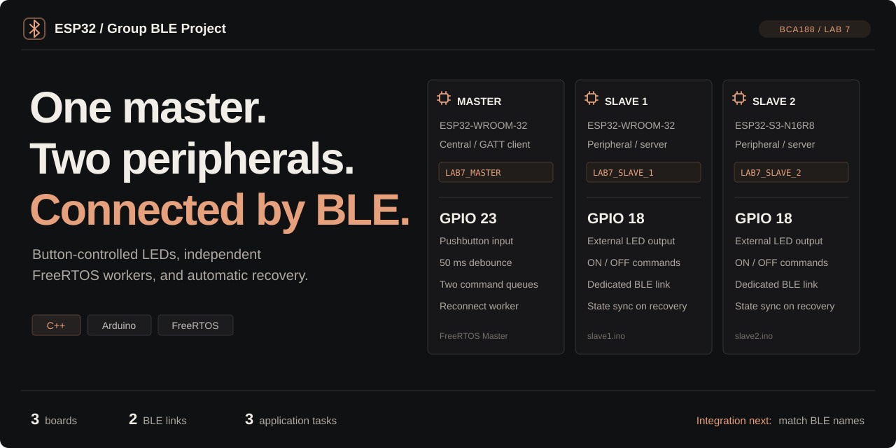
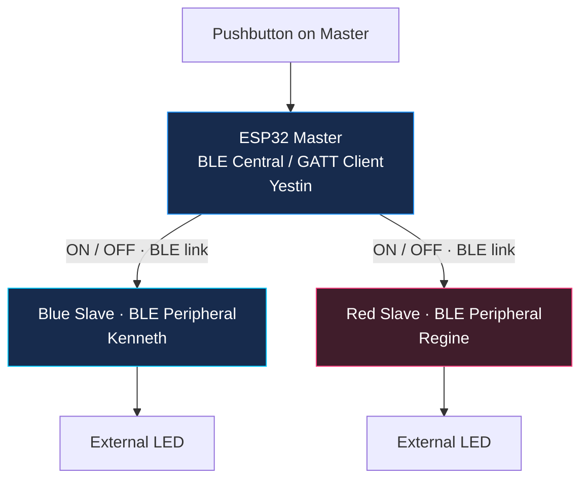

<a id="top"></a>

<p align="center">
  <picture>
    <source media="(max-width: 600px)" srcset="docs/assets/ble-cover-mobile.svg">
    
  </picture>
</p>

<p align="center">
  <a href="#integration-and-testing"></a>
  <a href="#architecture"></a>
</p>

<p align="center">
  <strong>Explore:</strong>
  <a href="#getting-started">Getting started</a> ·
  <a href="#firmware-and-branches">Firmware</a> ·
  <a href="#architecture">Architecture</a> ·
  <a href="#integration-and-testing">Testing</a> ·
  <a href="#team-and-contributions">Team</a>
</p>

<p align="center">
  <a href="#development-environment"></a>
  <a href="#development-environment"></a>
  <a href="#getting-started"></a>
</p>

<p align="center">
  <a href="#firmware-and-branches"></a>
  <a href="#hardware"></a>
  <a href="#architecture"></a>
  <a href="#architecture"></a>
</p>

# ESP32 Master-Slave BLE Communication

A collaborative implementation for **BCA188, Laboratory Activity 7** at **Mindanao State University–Iligan Institute of Technology (MSU-IIT)**.

The group is integrating one ESP32 Master and two BLE peripherals. The intended behavior is simple: hold the Master's pushbutton to switch both Slave LEDs on, then release it to switch them off. The Master contribution uses separate FreeRTOS command workers and a background reconnection worker.

Yestin develops the Master, Kenneth develops the Blue Slave, and Regine develops the Red Slave. Each member works on a separate branch before review and integration into `main`.

<table>
  <tr>
    <td width="33%" align="center" valign="top">
      <a href="#firmware-and-branches"><br><strong>Member branches</strong></a><br>
      <sub>Master, Blue Slave, and Red Slave development</sub>
    </td>
    <td width="33%" align="center" valign="top">
      <a href="#integration-and-testing"><br><strong>Integration checks</strong></a><br>
      <sub>Device names, GPIO pins, and three-board tests</sub>
    </td>
    <td width="33%" align="center" valign="top">
      <a href="#demonstrations-and-evidence"><br><strong>Demonstrations</strong></a><br>
      <sub>Group evidence and the separate individual reference</sub>
    </td>
  </tr>
</table>

> [!IMPORTANT]
> Group integration and hardware testing are pending. Yestin's separately tested individual build is a reference implementation; its results do not validate the group's firmware or hardware.

<a id="firmware-and-branches"></a>

##  Firmware and branches

| Component | Developer | Branch | Source organization |
| :--- | :--- | :--- | :--- |
| Master | Yestin Paraguya | [Paraguya](https://github.com/REGINE-BERMUDO/Master-Slave-BLE-Communication-ESP32/tree/Paraguya) | Master contribution to be integrated |
| Blue Slave | Kenneth O. Restauro | [Restauro](https://github.com/REGINE-BERMUDO/Master-Slave-BLE-Communication-ESP32/tree/Restauro) | `Slave_Blue.ino`, setup module, and BLE callback module |
| Red Slave | Regine Bermudo | [Bermudo](https://github.com/REGINE-BERMUDO/Master-Slave-BLE-Communication-ESP32/tree/Bermudo) | `Slave_Red.ino` and setup/callback definitions |
| Integrated project | Group | [main](https://github.com/REGINE-BERMUDO/Master-Slave-BLE-Communication-ESP32/tree/main) | Reviewed changes merged from member branches |

Source review found Slave implementations on the member branches while `main` still contained starter sketches. Use the relevant branch to inspect each member's work until integration is complete.

<a id="architecture"></a>

##  Architecture



Both Slave implementations use the shared service and writable characteristic below:

```text
Service         ec8817e4-164d-4c5e-8f2f-9b238a1b4e23
Characteristic  e70df770-9853-4704-bd6d-d18b3f8dfdb3
Commands        ON / OFF
```

The Master design debounces its button, remembers the requested LED state, and updates a one-item queue per Slave. Separate workers deliver commands; background recovery should reconnect a missing Slave and restore its latest state. The group must verify this behavior using the integrated firmware.

<a id="hardware"></a>

##  Hardware and configuration

The intended setup uses one Master board, two BLE-capable ESP32 Slave boards, a pushbutton, two LEDs with current-limiting resistors, jumper wires, breadboards, and USB data cables. Confirm the exact board variants and pin labels on the group's hardware before choosing Arduino targets.

| Component | Source-review configuration | Integration action |
| :--- | :--- | :--- |
| Master reference | Button on GPIO 23; expects `LAB7_SLAVE_1` and `LAB7_SLAVE_2` | Adapt discovery names and address fallbacks to the group's actual peripherals. |
| Blue Slave | Advertises `ESP32 Slave (Blue)`; LED macro uses GPIO 23 | Confirm the LED wiring and align discovery with the Master. |
| Red Slave | LED macro uses GPIO 18; command and connection callbacks are defined | Complete BLE initialization, service creation, callback registration, and advertising. |

The Blue Slave's reviewed source has an LED-pin comment that differs from its GPIO 23 macro. Use the configured macro and physical wiring when resolving that discrepancy. Device addresses recorded for Yestin's boards must be replaced if the Master uses address fallbacks on the group's boards.

Disconnect power before rewiring. Each external LED needs a current-limiting resistor and correct polarity. Wire the Master button between its configured input and GND when using `INPUT_PULLUP`.

<a id="getting-started"></a>

##  Getting started

```sh
git clone https://github.com/REGINE-BERMUDO/Master-Slave-BLE-Communication-ESP32.git
cd Master-Slave-BLE-Communication-ESP32
git switch Paraguya
```

1. Open the relevant member branch to inspect its firmware. Until changes are merged, one branch does not contain all members' latest implementations.
2. Integrate the Master contribution and both Slave implementations in a local checkout. Reconcile the discovery names, device-address fallbacks, GPIO assignments, and shared UUIDs.
3. Select the Arduino target and USB port for each physical board. Keep every sketch's `.ino`, `.h`, and `.cpp` files together; the sketch folder must match its main `.ino` filename.
4. Compile and upload both Slaves first. Confirm their advertising logs at **115200 baud**.
5. Compile and upload the Master, then power all three boards and run the integration tests below.

<a id="development-environment"></a>

### Development environment

Yestin's individual reference used **Arduino IDE 2.3.10** and **esp32 by Espressif Systems 3.3.11**, including the built-in BLE and FreeRTOS libraries. The environment badges above refer to that baseline. Confirm successful builds of each group sketch with the chosen board package and board targets before recording the group's tested environment.

<a id="integration-and-testing"></a>

##  Integration and testing

| Check | Group status |
| :--- | :--- |
| Add the Master contribution to `Paraguya` | Pending |
| Complete Red Slave BLE initialization | Pending |
| Reconcile Blue Slave name and LED pin | Pending |
| Confirm matching UUIDs and discovery settings | Pending integration check |
| Compile all three firmware targets | Not yet confirmed |
| Connect both Slaves and control both LEDs | Not yet confirmed |
| Disconnect each Slave while controlling the other | Not yet confirmed |
| Restore power and verify automatic recovery | Not yet confirmed |
| Reconnect a Slave while holding the button | Not yet confirmed |
| Review and merge member contributions into `main` | Pending |

Record the actual firmware revision, board targets, and observed outcomes when testing. BLE scan duration, connection timeouts, and the shared radio can affect response and recovery time.

<a id="demonstrations-and-evidence"></a>

##  Demonstrations and evidence

### Group project demonstrations

The recordings show the three-board ESP32 setup, Serial Monitor activity, pushbutton input, and LED outputs. Integration testing of the group's branch firmware is tracked separately in [Integration and testing](#integration-and-testing).

<details open>
<summary><strong>01 / Serial Monitor demonstration</strong> · Master and both Slaves</summary>

Discovery, connections, and ON/OFF command logs displayed together.

https://github.com/user-attachments/assets/093fc8ef-db45-4300-9b11-532496c234f9

</details>

<details open>
<summary><strong>02 / Physical hardware demonstration</strong> · Portrait video</summary>

The physical three-board setup, pushbutton, and LED outputs.

<table align="center" width="320">
  <tr>
    <td align="center" width="300">
      <video src="https://github.com/user-attachments/assets/4b69f4b7-eee0-44a6-8354-ccc0f447b353" width="300" controls="controls"></video>
    </td>
  </tr>
</table>

</details>

<a id="team-and-contributions"></a>

##  Team and contributions

| Member | Group responsibility | Development branch |
| :--- | :--- | :--- |
| [Yestin Paraguya](https://github.com/xavieryyyyyy) | Master firmware and Master-side integration | [Paraguya](https://github.com/REGINE-BERMUDO/Master-Slave-BLE-Communication-ESP32/tree/Paraguya) |
| [Kenneth O. Restauro](https://github.com/kinitgwapo) | Blue Slave firmware and BLE callbacks | [Restauro](https://github.com/REGINE-BERMUDO/Master-Slave-BLE-Communication-ESP32/tree/Restauro) |
| [Regine Bermudo](https://github.com/REGINE-BERMUDO) | Red Slave firmware and BLE callbacks | [Bermudo](https://github.com/REGINE-BERMUDO/Master-Slave-BLE-Communication-ESP32/tree/Bermudo) |

Each member develops on their own hardware. The group's integrated test results should be documented separately from Yestin's individual submission. Group/section and instructor details are awaiting confirmation.

<a id="references"></a>

##  References

- [Arduino-ESP32 documentation](https://docs.espressif.com/projects/arduino-esp32/en/latest/)
- [Espressif's built-in BLE library](https://github.com/espressif/arduino-esp32/tree/master/libraries/BLE)
- [FreeRTOS documentation](https://www.freertos.org/Documentation/RTOS_book.html)
- [Individual implementation and technical guide](https://github.com/xavieryyyyyy/esp32_master-slave-ble_comm)
- BCA188 laboratory materials and classroom instructions.

<p align="center">
  <a href="#top">Back to top</a> ·
  <a href="https://github.com/REGINE-BERMUDO/Master-Slave-BLE-Communication-ESP32">Group repository</a> ·
  <a href="https://github.com/xavieryyyyyy/esp32_master-slave-ble_comm">Individual reference</a>
</p>
