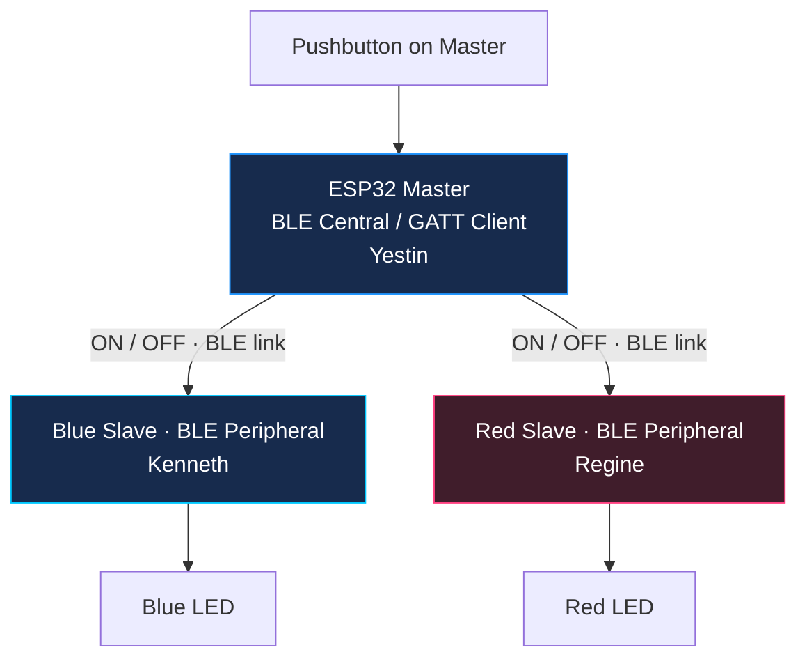

<a id="top"></a>

<p align="center">
  <picture>
    <source media="(max-width: 600px)" srcset="docs/assets/ble-cover-mobile.svg">
    
  </picture>
</p>

<p align="center">
  <a href="#demonstrations"></a>
  <a href="#architecture"></a>
</p>

<p align="center">
  <strong>Explore:</strong>
  <a href="#quick-start">Quick start</a> ·
  <a href="#demonstrations">Demonstrations</a> ·
  <a href="#architecture">Architecture</a> ·
  <a href="#integration-and-testing">Test results</a> ·
  <a href="docs/technical-guide.md">Technical guide</a> ·
  <a href="#branches">Branches</a> ·
  <a href="#team-and-contributions">Team</a>
</p>

<p align="center">
  <a href="#development-environment"></a>
  <a href="#development-environment"></a>
  <a href="#quick-start"></a>
</p>

<p align="center">
  <a href="#firmware"></a>
  <a href="#hardware"></a>
  <a href="#architecture"></a>
  <a href="#architecture"></a>
</p>

# ESP32 Master-Slave BLE Communication

One ESP32 Master controls the LEDs on two BLE peripherals. Hold the Master’s button to request `ON`; release it to request `OFF`. The Master firmware includes separate FreeRTOS command workers and a background reconnection worker.

This is the group project for **BCA188, Laboratory Activity 7** at **Mindanao State University–Iligan Institute of Technology (MSU-IIT)**. Yestin develops the Master, Kenneth develops the Blue Slave, and Regine develops the Red Slave.

<table>
  <tr>
    <td width="33%" align="center" valign="top">
      <a href="#firmware"><br><strong>Firmware</strong></a><br>
      <sub>Single-file and modular Master, plus two Slaves</sub>
    </td>
    <td width="33%" align="center" valign="top">
      <a href="#demonstrations"><br><strong>Watch the system</strong></a><br>
      <sub>Serial Monitor and physical hardware recordings</sub>
    </td>
    <td width="33%" align="center" valign="top">
      <a href="#hardware"><br><strong>Build the circuit</strong></a><br>
      <sub>Board setup, GPIO assignments, and wiring checks</sub>
    </td>
  </tr>
</table>

> [!IMPORTANT]
> The current `main` branch contains both Master versions, the Blue and Red Slave source folders, and the group demonstration recordings. Source review found that the Master’s discovery names do not match the names currently advertised by either Slave; see [hardware and wiring](#hardware) before assembling the boards.

<a id="demonstrations"></a>

##  Demonstrations

### Group project recordings

<details open>
<summary><strong>01 / Serial Monitor</strong> · Master and both Slaves</summary>

Discovery, connections, and ON/OFF command logs appear together.

https://github.com/user-attachments/assets/093fc8ef-db45-4300-9b11-532496c234f9

[Download the MP4](demo/01-serial-monitor-demonstration.mp4?raw=true)

</details>

<details>
<summary><strong>02 / Physical hardware</strong> · Portrait video</summary>

The recording shows the three-board setup, pushbutton, and LED outputs.

<table align="center" width="320">
  <tr>
    <td align="center" width="300">
      <video src="https://github.com/user-attachments/assets/4b69f4b7-eee0-44a6-8354-ccc0f447b353" width="300" controls="controls"></video>
    </td>
  </tr>
</table>

[Download the MP4](demo/02-actual-hardware-demonstration.mp4?raw=true)

</details>

<a id="quick-start"></a>

##  Quick start

The individual reference used **Arduino IDE 2.3.10** with **esp32 by Espressif Systems 3.3.11**. BLE and FreeRTOS are included in that board package. Use **115200 baud** for the Serial Monitor.

```sh
git clone https://github.com/REGINE-BERMUDO/Master-Slave-BLE-Communication-ESP32.git
cd Master-Slave-BLE-Communication-ESP32
```

1. Choose one Master: the [single-file sketch](master/master.ino) or the [modular sketch](master_modular/master_modular.ino). Keep every `.h` and `.cpp` file beside the modular `.ino` in the `master_modular` folder.
2. Choose one Master and open the Blue and Red Slave sketches from the folders in `main`. The [branch directory](#branches) links to each contributor branch and notes how its files differ from `main`.
3. Match the two Master discovery names to the Slave advertising names before uploading. Select the correct board targets and COM ports, then upload both Slaves before the Master.
4. Open the Serial Monitors at 115200 baud and verify discovery, connection, and LED commands.

Compile the selected Master and Slave sketches before uploading. The current Master sketches search for `LAB7_SLAVE_1` and `LAB7_SLAVE_2`; the Slave sketches advertise different names, as listed in [hardware and wiring](#hardware).

<a id="architecture"></a>

##  How it works



Both Slaves use the same GATT service and writable characteristic:

```text
Service         ec8817e4-164d-4c5e-8f2f-9b238a1b4e23
Characteristic  e70df770-9853-4704-bd6d-d18b3f8dfdb3
Commands        ON / OFF
```

The Master debounces the button, stores the requested LED state, and queues commands for each Slave. A background worker attempts to reconnect a missing Slave and send it the latest state. Both Slave folders in `main` contain setup and BLE callback modules.

<a id="firmware"></a>

##  Firmware

Use one Master implementation with both Slave sketches.

| Firmware | Source | Organization and status |
| :--- | :--- | :--- |
| Original Master | [`master/master.ino`](master/master.ino) | Present on `main`; byte-identical to the individually tested Master source. |
| Modular Master | [`master_modular/master_modular.ino`](master_modular/master_modular.ino) | Present on `main`; organized into BLE, button, shared-state, configuration, and FreeRTOS modules. |
| Blue Slave | [`Slave_Blue/Slave_Blue.ino`](Slave_Blue/Slave_Blue.ino) | Present on `main` with setup and BLE callback modules; original contribution is on `Restauro`. |
| Red Slave | [`Slave_Red/Slave_Red.ino`](Slave_Red/Slave_Red.ino) | Present on `main` with setup and callback modules; original contribution is on `Bermudo`. |

<details>
<summary><strong>Modular Master file map</strong></summary>

| File | Responsibility |
| :--- | :--- |
| [`Config.h`](master_modular/Config.h) | BLE names, UUIDs, pins, and timing |
| [`ButtonHandler.cpp`](master_modular/ButtonHandler.cpp) | Button input, debounce, and command queuing |
| [`BLEManager.cpp`](master_modular/BLEManager.cpp) | Discovery, connections, and recovery |
| [`RTOSTasks.cpp`](master_modular/RTOSTasks.cpp) | Command workers and reconnection worker |
| [`SharedState.cpp`](master_modular/SharedState.cpp) | Shared BLE objects, queues, mutexes, and LED state |

All files in `master_modular/` belong to one Arduino sketch and compile into one firmware image. Open `master_modular.ino` from the matching folder.

</details>

<a id="hardware"></a>

##  Hardware and wiring

The group setup uses one Master board, two BLE-capable ESP32 Slaves, a pushbutton, two LEDs with current-limiting resistors, breadboards, jumper wires, and USB data cables. Confirm board variants, pin labels, and resistor values against the physical build.

| Component | Source configuration | Check before testing |
| :--- | :--- | :--- |
| Master | Button on GPIO 23; looks for `LAB7_SLAVE_1` and `LAB7_SLAVE_2` | Change the Master names or Slave advertising names so the values match. |
| Blue Slave on `main` | Advertises `ESP32 SLAVE Blue`; LED macro uses GPIO 23 | Confirm the physical wiring uses GPIO 23 and align the advertising name with the Master. |
| Red Slave on `main` | Advertises `ESP32 SLAVE Red`; LED macro uses GPIO 18 | Confirm the physical wiring uses GPIO 18 and align the advertising name with the Master. |

The Master currently searches for `LAB7_SLAVE_1` and `LAB7_SLAVE_2`, which do not match either Slave name above. The `Restauro` branch uses a third Blue name, `ESP32 Slave (Blue)`, and the `Bermudo` branch has a typo in its Red name, `ESPS32 SLAVE Red`. Use the `main` versions as the README's source of truth, then make the Master and Slaves advertise matching names. Confirm the actual GPIO wiring before choosing pins. Disconnect power before rewiring; with `INPUT_PULLUP`, connect the button between the configured input and GND.

<a id="integration-and-testing"></a>

##  Test results and integration status

The original `master/master.ino` in this repository is byte-for-byte identical to the Master tested in Yestin’s individual project. Those results cover discovery, LED control, disconnect handling, and recovery with both Slaves.

| Scenario | Individual result | Evidence |
| :--- | :--- | :--- |
| Discover and connect to both Slaves | Passed | [Connection log](https://github.com/xavieryyyyyy/esp32_master-slave-ble_comm/blob/main/evidence/evidence-01-ble-discovery-connections.png) |
| Control both LEDs with the button | Passed | [ON/OFF communication](https://github.com/xavieryyyyyy/esp32_master-slave-ble_comm/blob/main/evidence/evidence-02-normal-ble-communication.png) |
| Disconnect Slave 1 while controlling Slave 2 | Passed | [Slave 1 disconnected](https://github.com/xavieryyyyyy/esp32_master-slave-ble_comm/blob/main/evidence/evidence-03-slave1-disconnection.png) |
| Disconnect Slave 2 while controlling Slave 1 | Passed | [Slave 2 disconnected](https://github.com/xavieryyyyyy/esp32_master-slave-ble_comm/blob/main/evidence/evidence-04-slave2-disconnection.png) |
| Restore each Slave and resume control | Passed | [Automatic recovery](https://github.com/xavieryyyyyy/esp32_master-slave-ble_comm/blob/main/evidence/evidence-05-automatic-reconnection.png) |
| Reconnect while holding the button | Evidence captured; video/log confirmation pending | [State synchronization](https://github.com/xavieryyyyyy/esp32_master-slave-ble_comm/blob/main/evidence/evidence-07-led-state-synchronization.png) |

The group demonstration videos above show the three-board setup. The test table links to results from Yestin’s individually tested Master setup.

<a id="branches"></a>

## Repository branches

Use these links to open each project branch directly:

| Branch | Project files |
| :--- | :--- |
| [`main`](https://github.com/REGINE-BERMUDO/Master-Slave-BLE-Communication-ESP32/tree/main) | Current consolidated files: both Masters, complete Blue and Red Slave folders, README assets, and demonstration videos. |
| [`Paraguya`](https://github.com/REGINE-BERMUDO/Master-Slave-BLE-Communication-ESP32/tree/Paraguya) | Yestin’s Master, modular Master, README assets, and demonstrations; the Slave folders on this branch contain only starter `.ino` files. |
| [`Restauro`](https://github.com/REGINE-BERMUDO/Master-Slave-BLE-Communication-ESP32/tree/Restauro) | Blue Slave contribution by Kenneth. |
| [`Bermudo`](https://github.com/REGINE-BERMUDO/Master-Slave-BLE-Communication-ESP32/tree/Bermudo) | Red Slave contribution by Regine. |

The current `main` tree already contains the Master, modular Master, both complete Slave folders, repository graphics, and both demonstration videos. The older `Paraguya` branch has only the Slave starter sketches; use `main` for the consolidated source.

<a id="team-and-contributions"></a>

##  Team and contributions

| Member | Responsibility | Profile |
| :--- | :--- | :--- |
| Yestin Paraguya | Master firmware, integration work, README, and demonstration recordings | [@xavieryyyyyy](https://github.com/xavieryyyyyy) |
| Kenneth O. Restauro | Blue Slave firmware | [@kinitgwapo](https://github.com/kinitgwapo) |
| Regine Bermudo | Red Slave firmware | [@REGINE-BERMUDO](https://github.com/REGINE-BERMUDO) |

## Supporting files

The group technical guide is in [`docs/technical-guide.md`](docs/technical-guide.md). The remaining physical documentation to add is a wiring diagram or photos of the group's actual boards. Circuit photos and test screenshots in Yestin’s individual repository document his separate reference setup.

<a id="references"></a>

##  References

- [Arduino-ESP32 documentation](https://docs.espressif.com/projects/arduino-esp32/en/latest/)
- [Espressif BLE library](https://github.com/espressif/arduino-esp32/tree/master/libraries/BLE)
- [FreeRTOS documentation](https://www.freertos.org/Documentation/RTOS_book.html)
- [Yestin’s individual project and technical guide](https://github.com/xavieryyyyyy/esp32_master-slave-ble_comm)
- BCA188 laboratory materials and classroom instructions.

<p align="center">
  <a href="#top">Back to top</a> ·
  <a href="https://github.com/REGINE-BERMUDO/Master-Slave-BLE-Communication-ESP32">Group repository</a> ·
  <a href="https://github.com/xavieryyyyyy/esp32_master-slave-ble_comm">Individual reference</a>
</p>
